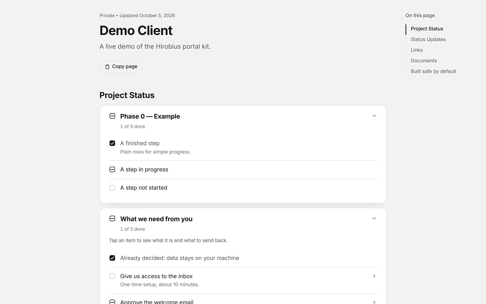

# Hirobius Portal Kit

One shared theme and renderer for client status portals. A client page ships only data.



**Live:** https://portal-kit-jet.vercel.app

## Stack

- Plain static files. There is no build step and no package.json.
- `theme.css` is the design system: type, palette, status pills, cards, light and dark.
- `portal.js` builds the full page from a JSON data block in the client page.
- Hosted on Vercel. Client pages on other domains load a pinned release from this host.
- The tools use Node built-ins only.

## Run it

```bash
python3 -m http.server 8000         # the demo, at http://localhost:8000
node --test tools/*.test.mjs        # the tool tests
node scripts/check-repo-docs.mjs    # the docs check
```

## Structure

- `theme.css`, `portal.js` - the working (edge) build of the theme and the renderer.
- `index.html` - the demo. It renders sample data through the kit.
- `releases/vN/` - frozen copies that client pages pin. See [RELEASES.md](RELEASES.md).
- `clients/` - the example client page and the registry of live client pages.
- `tools/` - page check, link sync, client check and the shared password gate.
- `fonts/`, `vendor/` - self-hosted fonts and the Mermaid bundle.
- `docs/` - guides, one subject per file.

## Docs

- [How a client page uses the kit, and how to start one](docs/new-client.md)
- [Data shape and section types](docs/data-shape.md)
- [Restyle every portal](docs/restyle.md)
- [What the host serves](docs/host.md)
- [Releases](RELEASES.md)

## Contributing

See [CONTRIBUTING.md](CONTRIBUTING.md). Report a security problem as [SECURITY.md](SECURITY.md) says.

## License

All rights reserved. No license is granted. The files in `fonts/` and `vendor/` keep their own
licenses, which are next to them.
